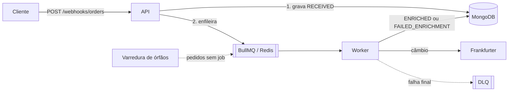

# Orquestrador de Pedidos

API em **NestJS** que recebe pedidos por **webhook**, garante **idempotência**, enfileira o processamento e
**enriquece** cada pedido convertendo o total para BRL com a [Frankfurter](https://frankfurter.dev) (câmbio, sem
chave de API). Falhas temporárias são **retentadas com backoff**; o que falha de vez vai para uma **DLQ** e o pedido
termina em `FAILED_ENRICHMENT`.

Solução do [desafio backend pleno](https://github.com/buzzmates/desafio-backend-pleno). As decisões de arquitetura,
com o motivo de cada uma, estão em **[docs/DECISIONS.md](docs/DECISIONS.md)**.



## Como rodar

Requisito: **Docker** (com Docker Compose).

```bash
cp .env.example .env
```

```bash
docker compose --profile app up --build
```

A API sobe em `http://localhost:3000` com MongoDB e Redis. **Swagger: <http://localhost:3000/docs>**.

Envie um pedido:

```bash
curl -i -X POST localhost:3000/webhooks/orders -H 'content-type: application/json' -d '{
  "order_id": "ext-123",
  "customer": { "email": "user@example.com", "name": "Ana" },
  "items": [{ "sku": "ABC123", "qty": 2, "unit_price": 59.9 }],
  "currency": "USD",
  "idempotency_key": "5f0c1a2e-9a7b-4c1d-8e3f-1b2c3d4e5f60"
}'
```

Resposta `202` com o `id` do pedido. Em instantes ele está enriquecido:

```bash
curl localhost:3000/orders/<id>
```

```json
{
  "id": "6af45d4c4d4329bf2fd540b6", "order_id": "ext-123", "status": "ENRICHED",
  "currency": "USD", "total": 119.8, "revision": 1,
  "enrichment": { "target_currency": "BRL", "rate": 5.5517, "rate_date": "2026-11-10", "converted_total": 665.09 },
  "failure": null
}
```

Reenviar o mesmo corpo responde `200` com o mesmo pedido (idempotência).

### Desenvolvimento local

Node 24 e pnpm 10.

```bash
pnpm install
```

```bash
pnpm infra:up
```

```bash
pnpm start:dev
```

`pnpm infra:up` sobe só o MongoDB e o Redis do compose; a app roda na máquina com hot reload.

## Endpoints

| Método e rota | O que faz |
|---|---|
| `POST /webhooks/orders` | Recebe o pedido. **202** criado/atualizado, **200** duplicado (mesma `idempotency_key`), **400** payload inválido, **409** conflito, **413** corpo grande demais, **422** chave reaproveitada para outro pedido |
| `GET /orders?status=&order_id=&limit=&cursor=` | Lista, mais recentes primeiro, paginada por cursor (`next_cursor`) |
| `GET /orders/:id` | Detalhes de um pedido |
| `GET /queue/metrics` | Jobs por estado, pausa do circuit breaker e total na DLQ |
| `POST /orders/reprocess` | Reenvia pedidos `FAILED_ENRICHMENT` (por ids ou em lote), com prioridade baixa |
| `GET /webhooks/rejections?request_id=` | Auditoria dos webhooks recusados (dados pessoais mascarados) |
| `GET /health` | `ok` / `degraded` (200) ou `down` (503) |

Todos os erros têm o mesmo formato, com um `code` estável e o `request_id` (também no header `x-request-id`):

```json
{ "statusCode": 400, "code": "INVALID_PAYLOAD", "message": "The payload is invalid",
  "request_id": "req_6346e2db-...", "errors": [{ "field": "items.0.qty", "message": "qty must be a positive number" }] }
```

Status do pedido: `RECEIVED → ENRICHING → ENRICHED`, ou `FAILED_ENRICHMENT` com `failure.reason`
(`UNSUPPORTED_CURRENCY`, `PROVIDER_UNAVAILABLE`, `PROVIDER_REJECTED`, `INTERNAL_ERROR`) e `failure.retryable`.

## Decisões principais

Resumo; o raciocínio completo está em [docs/DECISIONS.md](docs/DECISIONS.md).

- **Stack:** NestJS 12 · MongoDB (Mongoose) · BullMQ (Redis) · Vitest + Testcontainers. BullMQ porque o problema é
  uma fila de jobs dentro de um serviço (retry com backoff, dedup por `jobId` e métricas nativos); RabbitMQ faria
  sentido entre serviços e Kafka seria exagero.
- **Idempotência em três camadas:** índice único no MongoDB (fonte da verdade, inclusive sob requisições
  simultâneas), dedup por `jobId` na fila e o worker ignorando pedidos já finalizados. Requisições que perdem uma
  corrida são reavaliadas e respondem como duplicadas.
- **Banco antes da fila, e o Redis fora não derruba o recebimento:** o pedido é gravado primeiro; se o enqueue
  falhar (com retry curto e falha rápida medida), a resposta continua 202 e uma **varredura de órfãos** enfileira
  depois.
- **Retry, DLQ e circuit breaker:** erro temporário tenta de novo com backoff exponencial; erro permanente (4xx) ou
  tentativas esgotadas → `FAILED_ENRICHMENT` + cópia na DLQ. Com a Frankfurter fora, o circuito abre e **pausa a
  fila sem gastar tentativas**.
- **Moeda não suportada** é detectada no recebimento: 202, `FAILED_ENRICHMENT`, sem ocupar a fila.
- **Reprocessamento** pela mesma fila com prioridade baixa: pedidos novos sempre passam na frente.
- **LGPD:** respostas e logs nunca têm e-mail/nome; a auditoria dos 400 guarda só campos do contrato, mascarados,
  com expurgo automático (TTL).
- **`ORDER_DUPLICATE_POLICY`:** `reject` (padrão, 409) ou `update` para o mesmo `order_id` com outra chave.
- **`WORKER_ENABLED`:** a mesma imagem roda como API + worker ou só API, para escalar separadamente.

## Arquitetura

Ports & adapters: os casos de uso não conhecem Nest, MongoDB nem BullMQ.

```
src/
├── orders/
│   ├── domain/         Order (máquina de status, dinheiro em centavos) — puro
│   ├── application/    casos de uso + ports (classes abstratas)
│   ├── infra/          MongoDB, BullMQ (produtor, worker, varredura), Frankfurter + circuit breaker
│   └── http/           controllers, DTOs, apresentação
├── rejections/         auditoria dos webhooks recusados
├── health/             /health com três estados
└── shared/             circuit breaker, tarefa periódica, formato de erro, request id
```

## Testes

TDD do começo ao fim. Três suítes:

| Suíte | O que cobre | Comando |
|---|---|---|
| Unit | Domínio e casos de uso com fakes em memória (inclusive corridas e Redis fora simulados) | `pnpm test` |
| Integração | Adapters contra MongoDB e Redis **reais** (Testcontainers) e a Frankfurter mockada | `pnpm test:int` |
| E2E | A app inteira por HTTP: webhook → fila → worker → pedido, DLQ, circuito, varredura, auditoria | `pnpm test:e2e` |

Integração e e2e sobem os containers sozinhos (só precisam do Docker rodando).

- **Teste de contrato:** a mesma suíte do repositório roda contra o fake e contra o MongoDB real, provando que o fake
  usado pelos testes de casos de uso se comporta como o banco.
- **Comportamentos de infraestrutura medidos, não assumidos:** o enqueue com o Redis parado/travado, o rate limit do
  BullMQ não gastando tentativas, a prioridade da fila e as respostas reais da Frankfurter foram conferidos e viraram
  testes.
- **Mutantes:** cada regra importante foi quebrada de propósito para confirmar que algum teste falha. Isso revelou
  testes fracos, que foram reforçados.
- **O que os testes pegaram:** uma corrida real entre duas requisições idênticas (encontrada pelo e2e de 10
  requisições simultâneas), o BullMQ pendurando com o Redis fora, `jobId` inválido para chaves com `:` e outros —
  todos documentados em [docs/DECISIONS.md](docs/DECISIONS.md).

## Configuração

Todas as variáveis estão comentadas em [`.env.example`](.env.example) e são validadas no boot (a app não sobe com
configuração inválida). As principais:

| Variável | Padrão | |
|---|---|---|
| `ENRICHMENT_TARGET_CURRENCY` | `BRL` | Moeda de destino da conversão |
| `ENRICHMENT_MAX_ATTEMPTS` / `ENRICHMENT_BACKOFF_MS` | `5` / `1000` | Tentativas e base do backoff exponencial |
| `CIRCUIT_FAILURE_THRESHOLD` / `CIRCUIT_RESET_TIMEOUT_MS` | `5` / `30000` | Circuit breaker da Frankfurter |
| `ORDER_DUPLICATE_POLICY` / `MAX_ORDER_REVISIONS` | `reject` / `10` | Mesmo `order_id` com outra chave |
| `STALE_ORDER_AFTER_MS` / `SWEEP_INTERVAL_MS` | `120000` / `60000` | Varredura de órfãos |
| `REPROCESS_MAX_COUNT` | `3` | Máximo de reprocessos por pedido |
| `REJECTION_RETENTION_DAYS` | `90` | Retenção da auditoria (LGPD) |
| `WORKER_ENABLED` | `true` | `false` = processo só de API |

## Melhorias futuras

Ficaram fora do escopo de propósito; o porquê de cada uma está em [docs/DECISIONS.md](docs/DECISIONS.md).

- **Autenticação do webhook com assinatura HMAC** e rate limit (hoje quem conhece a URL envia pedidos).
- **Outbox transacional** para a consistência banco ↔ fila em segundos (hoje a varredura cobre em minutos).
- **Varredura de pedidos presos em `ENRICHING`** (caso raro: o banco cai justamente ao gravar a falha).
- **Reprocessamento automático** quando o circuito fecha (hoje é manual).
- **Circuit breaker compartilhado** entre instâncias (hoje cada processo tem o seu).
- Exportação da auditoria em tempo real (Change Streams) para uma ferramenta de observabilidade.
