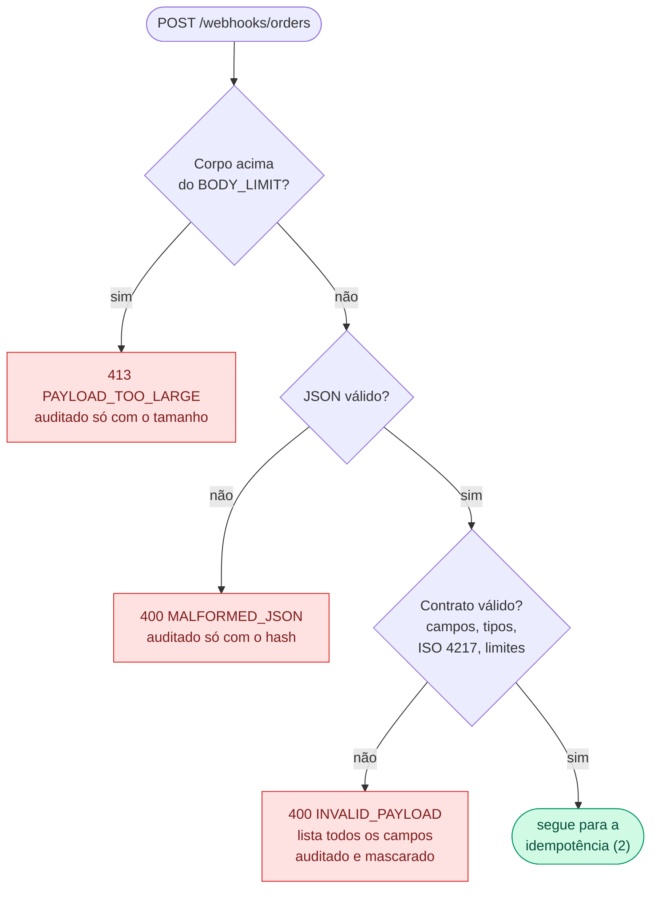
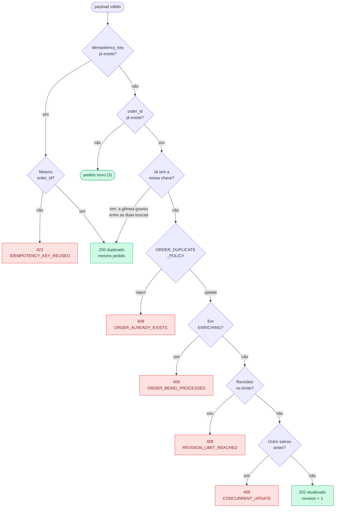
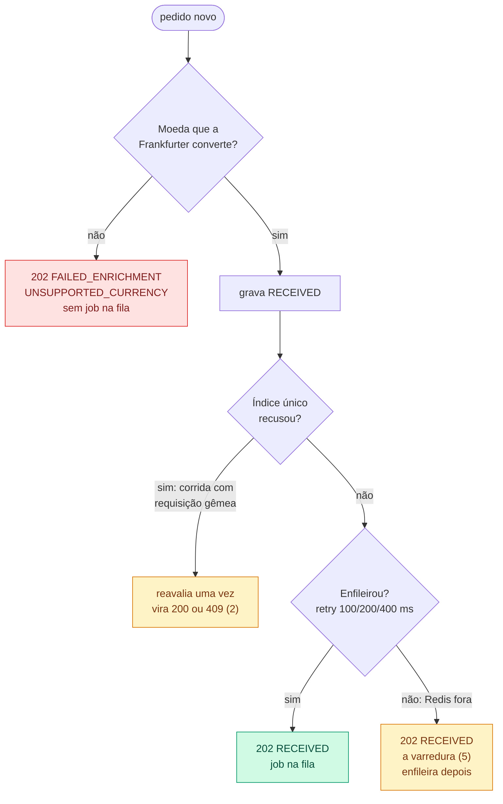
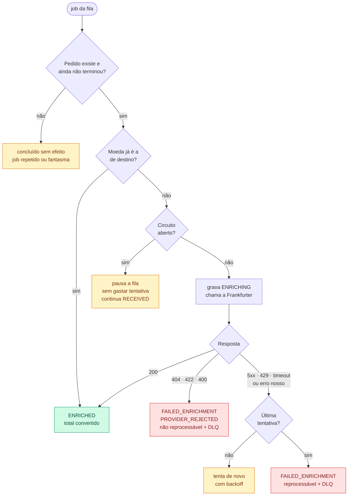
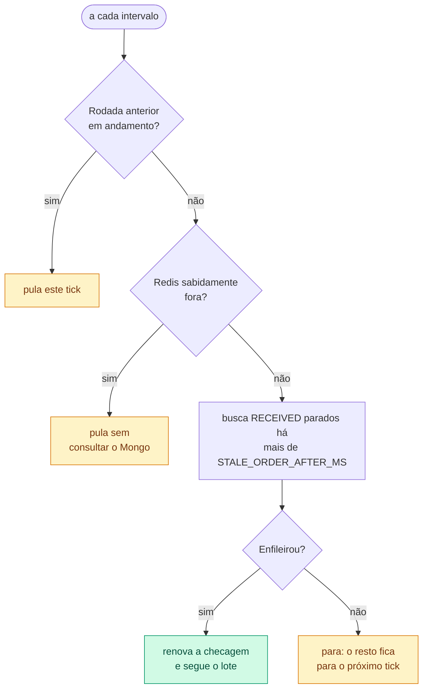
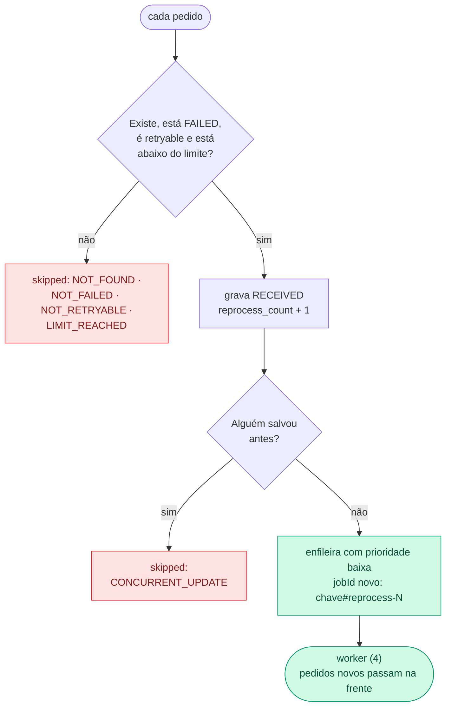
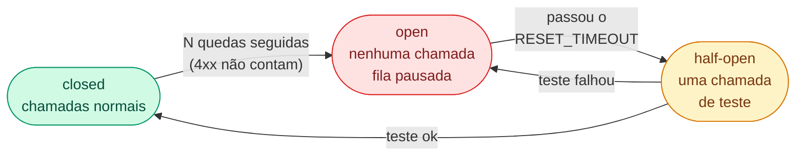

# Fluxos das regras de negócio

Caminho feliz e caminhos tristes, em partes pequenas. O porquê de cada regra está em [DECISIONS.md](DECISIONS.md).

**Legenda:** 🟩 caminho feliz · 🟥 recusa ou falha · 🟨 recuperação automática (algo deu errado e o sistema se corrige)

- [1. Webhook: contrato](#1-webhook-contrato)
- [2. Webhook: idempotência e conflitos](#2-webhook-idempotência-e-conflitos)
- [3. Webhook: pedido novo](#3-webhook-pedido-novo)
- [4. Worker de enriquecimento](#4-worker-de-enriquecimento)
- [5. Varredura de órfãos](#5-varredura-de-órfãos)
- [6. Reprocessamento](#6-reprocessamento)
- [7. Circuit breaker da Frankfurter](#7-circuit-breaker-da-frankfurter)

## 1. Webhook: contrato

Toda violação de contrato é recusada **e auditada** em `webhook_rejections` (dados pessoais mascarados).

## 2. Webhook: idempotência e conflitos

Duas recuperações por trás desses caminhos: no **200 duplicado**, se o pedido ainda está `RECEIVED`, ele é
reenfileirado (o enqueue original pode ter falhado; o dedup por `jobId` torna isso seguro). No **202 atualizado**,
um pedido que já tinha terminado volta para `RECEIVED` e ganha um job novo.

## 3. Webhook: pedido novo

O pedido é gravado **antes** de enfileirar: se a fila falhar, sobra um pedido sem job (recuperável), nunca um job
sem pedido.

## 4. Worker de enriquecimento

Cada job tem até `ENRICHMENT_MAX_ATTEMPTS` tentativas com backoff exponencial.

Dois detalhes que não cabem no desenho: se o cliente atualizar o pedido enquanto o worker trabalha, o lock otimista
manda o job tentar de novo com os dados novos; e se as tentativas acabarem com o pedido ainda `RECEIVED`, o worker
apaga o job falho para liberar o `jobId` e a varredura reenfileira.

## 5. Varredura de órfãos

Roda a cada `SWEEP_INTERVAL_MS` e pega pedidos `RECEIVED` sem job (o enqueue falhou e o cliente não repetiu).

## 6. Reprocessamento

`POST /orders/reprocess`, por ids ou em lote. Cada pedido recusado volta com o motivo.

## 7. Circuit breaker da Frankfurter

